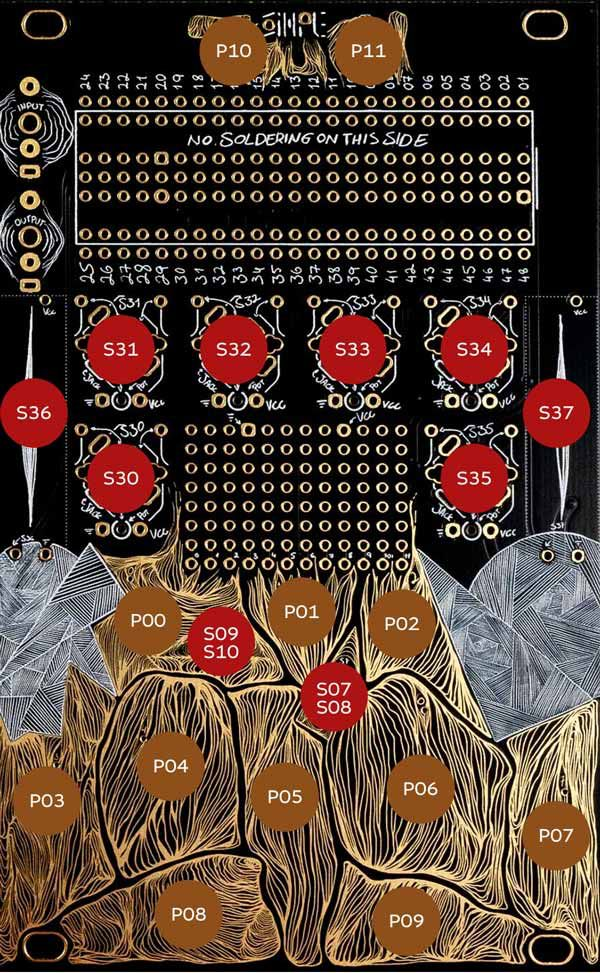

# Clessidra

Granular instrument for the Synthux Simple Touch, inspired by the hourglass.

## Controls



One layer: every control does one thing, where it is. The recording is the sand, the selection how much of it is in the glass.

| Control | Name | Does |
|---|---|---|
| S36 | Speed | How fast the glass empties: stopped at the bottom, 1× at the centre, 4× at the top |
| S37 | Flow | The neck: closed, single drops, a stream, a cloud. Moves density (0.3 to 131 grains per second), size (30 to 300 ms), window (percussive to Hann) and reverb (more for a lone drop) together. Near the top the cloud scatters by itself |
| S30 | Position | Where the sand starts, anywhere in the recording. Held: moves the point |
| S35 | Length | How much sand: the selection, past the end round to the start. The playhead stays where it is |
| S31 | Size | A quarter to four times Flow's size, up to half the recording |
| S32 | Scatter | Plain and periodic at 0. Up: random starts, places, sizes, shapes, wider pan, mostly near with a long tail. Top quarter: random pitch, up to ±12 semitones |
| S33 | Pitch | ±12 semitones, stops at 0, 0.1, 5, 7, 12 |
| S34 | Tone | Low-pass down, 20 kHz to 200 Hz. Off at the centre. High-pass up, to 2 kHz |
| S09 | Direction | Forward, held, reverse. Flicked: the glass turned over |
| S07 | End | When the sand runs out: up stops, centre turns over by itself, down loops. The slices too |

| Pad | Name | Does |
|---|---|---|
| P10 | Record | Tap: the last 8 s. Hold: until release, up to 30 s, the input heard. A new recording pours in over 2 s |
| P11 | Shake | Held: Scatter towards the top, firmer for more. Let go, it settles |
| P00 | Mute | Held: the grains silent, the reverb rings on |
| P01 | Drop | A touch: one grain at the playhead, whatever Flow |
| P02 | Restart | The sand back to the top: the playhead to the selection start |
| P03–P09 | Slices | At the recording's onsets. Each plays its own grains, as End sets. Flow at least half open, pressure opens it further |

| LED | |
|---|---|
| Glow | Grains falling, dimmer as the sand runs out |
| Flash | Recording |
| Pulse | At a centre: unison, speed 1×, Flow's size, tone off |

## Play in the Browser

[francescodimaggio.nl/clessidra](https://francescodimaggio.nl/clessidra/): the same firmware, compiled to WebAssembly.

## Install

Download the [binary](https://github.com/francesco-di-maggio/clessidra/releases/latest/download/Clessidra.bin) and flash it with the [Daisy Seed web programmer](https://electro-smith.github.io/Programmer/).

## Build

Needs the [Daisy Toolchain](https://daisy.audio/tutorials/cpp-dev-env/).

```shell
git clone --recurse-submodules https://github.com/francesco-di-maggio/clessidra.git
cd clessidra
make libs
make
```

Hold BOOT, press and release RESET, release BOOT, then:

```shell
make program-dfu
```

## License

MIT
