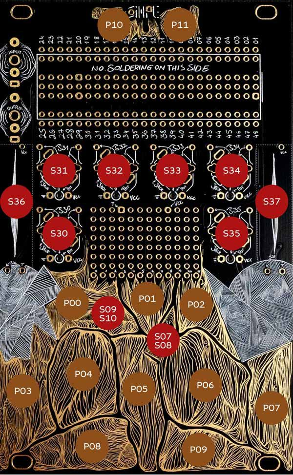

# Clessidra

A real-time granular sampler inspired by the hourglass, for the Synthux Simple Touch 2.



## Install

Download the [binary](https://github.com/francesco-di-maggio/clessidra/releases/latest/download/clessidra.bin) and flash it with the [Daisy Seed web programmer](https://flash.daisy.audio/).

## Controls

| Control | Function | P11 held |
|---|---|---|
| S36 | Speed 0–4×, stops at ¼ ½ 1 2 4 | Volume |
| S37 | Density: 0–320 a second, stops at 1 5 20 80 | Jitter: regular to random |
| S30 | Position: where the loop starts | Filter: low-pass / off / high-pass |
| S35 | Length: a share of the rest | Reverb |
| S31 | Size: 5 ms – 2 s, 100 ms at the centre | Random size |
| S32 | Spray: scattered round the playhead | Spread: each grain's pan |
| S33 | Pitch ±24 semitones, musical stops | Random pitch: up free, down octaves |
| S34 | Shape: square, decay, bell, reverse | Random shape |
| S09 | Forward / freeze / reverse | |
| S07 | End: loop / turn over / once | |
| P10 | Record. Tap: the last 8 s. Hold: up to 30 s | Listen: the input alone. Let go of P11: record |
| P11 | Hold: the second layer | |
| P00 | Stop: light slows, firm halts | |
| P01 | Reset: second layer to defaults | |
| P02 | Trigger: the loop from its start | |
| P03–P09 | Slices: hold, firmer is louder | |

[Manual (PDF)](https://francescodimaggio.nl/clessidra/clessidra-manual.pdf) · [Controls](https://francescodimaggio.nl/clessidra/controls/) · [Play in the browser](https://francescodimaggio.nl/clessidra/play/) · [Video](https://youtu.be/RqA2F2Bw7CE)

## Build

Needs the [Daisy Toolchain](https://github.com/electro-smith/DaisyWiki/wiki/1.-Setting-Up-Your-Development-Environment).

```shell
git clone --recurse-submodules https://github.com/francesco-di-maggio/clessidra.git
cd clessidra
make libs
make
```

Hold BOOT, press and release RESET, release BOOT, then:

```shell
make program-dfu
```

## License

MIT
